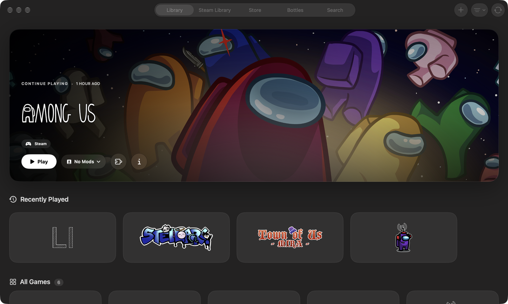
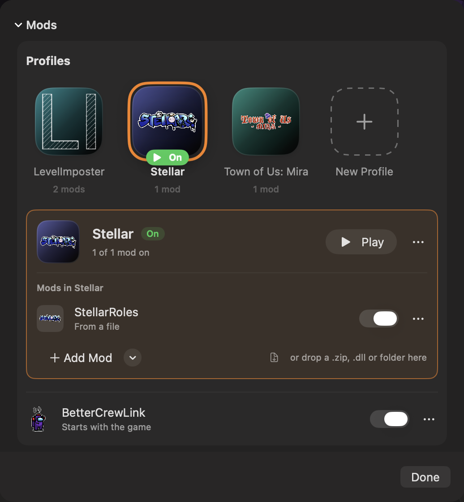
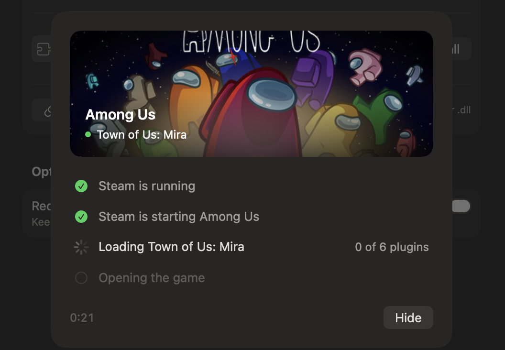

<div align="center">

  # BetterWhisky

  **Whisky, with one-click mods.** Install a mod from GitHub, press Play, and BetterWhisky
  handles the rest: the right download, the install steps, the game version the mod needs,
  and starting it through Steam so you stay signed in.

  A fork of [frankea/Whisky](https://github.com/frankea/Whisky), the community continuation of
  [Whisky](https://github.com/whisky-app/whisky). Not affiliated with either project.

</div>

<p align="center">
  <a href="https://github.com/JasonForReels/BetterWhisky/releases/latest"><b>Download BetterWhisky for Mac</b></a>
  · <a href="https://whisky.jasonforreels.com">Website</a>
</p>



*Each mod profile gets its own card, with its mod's logo. The button beside Play picks which profile to play.*

## Install

1. Download `BetterWhisky-<version>.dmg` from the [latest release](https://github.com/JasonForReels/BetterWhisky/releases/latest).
   It's signed and notarised by Apple.
2. Open the DMG and drag **BetterWhisky** into **Applications**, then open it from there.
3. On first launch, BetterWhisky sets itself up: it installs Rosetta 2 if your Mac doesn't have
   it and downloads the Wine engine (about 480 MB). This happens once.

BetterWhisky updates itself after that. When a new version is out, it offers to install it.

## How to use BetterWhisky

### 1. Make a bottle

A **bottle** is its own Windows setup on your Mac. Games installed in it share its settings.

1. Click **+** at the top right.
2. Give it a name (for example *Steam Games*), keep **Windows 10** unless a game says otherwise,
   and click **Create**.

### 2. Install Steam (or any Windows program)

1. Download the Windows installer from the program's site, for example `SteamSetup.exe` from
   [steampowered.com](https://store.steampowered.com/about/).
2. Open the **Bottles** tab, click your bottle, then click **▶ Run…** in the toolbar and choose
   the installer. You can also drag the `.exe` onto the BetterWhisky window.
3. Follow the installer as you would on Windows.

Installed programs and Steam games appear in the **Library** tab on their own. To keep a program
handy, pin it: **Bottles** → your bottle → **Pin Program**.

### 3. Play

- In the **Library**, click a game, or hover it and click **▶**. Steam games start through
  Steam, so you stay signed in.
- **Search** finds games, mods and bottles as you type.
- Right-click a card for **Mods…**, **Configure Bottle**, or, for a pinned program,
  **Show in Finder** and **Remove Pin**.

### 4. Add mods with profiles

Mods live in **profiles**, like profiles on a streaming service. Each profile is its own copy of
the game with whichever mods you pick, all loading together: StellarRoles with LevelImposter,
Town of Us: Mira on its own, or all three.

1. In the **Library**, hover a game that supports mods and click the **gear**, or right-click it
   and choose **Mods…**.
2. Click **New Profile** and name it.
3. Click **Add Mod** on the profile: pick a built-in mod, **From GitHub…** (paste the mod's
   link), or **From Files or Folders…** (`.zip`s, `.dll`s or whole mod folders). **Add Several
   Mods…** lets you tick several at once, and **New Profile** can start with mods ticked. You can
   also drop any of those onto the profile.
4. BetterWhisky shows what it will install before it changes anything. A new mod never replaces
   files another mod in the profile put there.

Each mod in a profile has its own on/off switch. To play, press **Play** on the profile, use the
profile button beside **Play** on the Library banner, or right-click a game and choose
**Play With**. Mods update themselves; a profile's **⋯** menu copies, renames or removes it.

### Change a bottle's settings

**Bottles** → your bottle → **Bottle Configuration**. Settings are grouped like System Settings:
General (Windows version, Wine), Graphics & Display, Audio, Controllers & Input, Game Launchers,
Performance, Windows Components and Diagnostics & Repair. Control Panel, Registry Editor and
Wine Configuration are under **Windows Tools**.

If a game won't start, **Diagnostics & Repair** has a guided troubleshooter and can read the
game's crash log.

## What BetterWhisky adds

- **Profiles with any mix of mods.** Pick a profile like on a streaming service, and every mod
  in it loads together, each with its own switch. Add mods from GitHub, a `.zip`, a `.dll` or a
  whole folder; switch profiles from the Library banner.
- **Mods that keep their own account start signed in.** Before Play, any mod that keeps its own
  copy of the game's account save gets yours, so it doesn't stop on the Privacy Policy screen.
- **Mods from GitHub in one click.** Built-in presets (Town of Us: Mira and The Other Roles for
  Among Us), or paste any GitHub repo. BetterWhisky takes the **latest release**, reads the
  install steps from its **release notes and README**, and shows you the plan before it
  changes anything. Dropping a `.zip` or `.dll` works too.
- **Dependencies installed for you.** Other mods a README says it needs (Reactor, MiraAPI, …)
  come from their own latest releases; Windows runtimes (Visual C++, .NET, XNA) go in through
  winetricks.
- **Each mod keeps the game version it was made for.** A mod installs into its own copy of the
  game (an instant APFS clone, so no extra space until Steam changes the original). When Steam
  updates the game, the regular card plays the new version and the modded card keeps working on
  the old one until the mod catches up.
- **Plays through Steam, so you stay signed in.** Games like Among Us only sign you in when Steam
  starts them. BetterWhisky sets Steam up once, then Steam starts whichever version you picked.
- **Mods update themselves.** BetterWhisky checks for new releases. When one supports the
  current game, it downloads it and moves the mod onto the new game; until then it leaves it be.
  A release made for a different game version is refused with a clear reason.
- **Faster modded starts.** Steam starts in the background when BetterWhisky opens, and mod
  code is pre-compiled on your Mac with Microsoft's crossgen2. Together they took a modded
  Among Us start from about 3½ minutes to under 2.
- **A loading screen that tells the truth.** Each stage is read from the log it writes:
  Steam signing in, Steam starting the game, the mod loading (with a plugin count), the game
  opening.

<p>
  
  &nbsp;
  
</p>

*Left: a game's mod profiles. Right: a modded start, stage by stage.*

## How a modded start works

```text
Play  →  Steam (already running)  →  launch script picks the version  →  BepInEx loads the mod  →  game
```

1. The mod lives in `steamapps/common/<Game> Mods/<Mod>/game`, a frozen copy of the game with
   the mod installed into it.
2. Steam's launch option for the game is set once to a small BetterWhisky script. The script
   starts the modded copy when a mod is selected, and the game Steam installed when not.
3. BepInEx needs Wine to use the mod's `winhttp.dll`; BetterWhisky sets that on the game so
   Steam launches carry it.

## Memory

Measured with Town of Us: Mira at the Among Us menu on an 8 GB Mac:

| | Memory |
| --- | --- |
| Modded Among Us | ~2.0 GB |
| Steam's built-in browser (runs even when Steam is hidden) | ~2.2–2.4 GB |
| Steam client, helpers and Wine | ~0.5 GB |
| **Total** | **~4.9 GB** |

The mod's .NET runtime runs in conserve-memory mode (on by default, under **Reduce memory use**
in a game's mod settings). BetterWhisky never pauses or closes Wine or Steam processes to save
memory: it saves little and makes games crash.

## Requirements

- Apple Silicon Mac, macOS Sequoia 15.0 or later
- Rosetta 2 (installed during first-run setup)
- About 1.5 GB for the Wine engine, plus your bottles and games

## Building

To build BetterWhisky yourself instead of downloading it, use Xcode:

```sh
git clone https://github.com/JasonForReels/BetterWhisky.git
cd BetterWhisky
brew install swiftlint
xcodebuild -project Whisky.xcodeproj -scheme Whisky -configuration Release build
```

On first launch it downloads the Wine runtime (about 480 MB). BetterWhisky uses its own app ID
(`com.thejaysmith.BetterWhisky`), so it runs beside Whisky without sharing bottles; use
**File → Import Bottle** to bring one over.

## Known issues

- **Telemetry** is off unless you opt in during setup; if you do, events go to the upstream
  project's analytics.
- The Library needs a manual refresh after installing a mod.
- Steam's window can draw blank under the current Wine runtime on macOS 27
  ([frankea/Whisky#248](https://github.com/frankea/Whisky/issues/248)); waiting usually helps.
- Mods are tested with Among Us (Town of Us: Mira). Other games and mod loaders may need presets.

## Everything else from Whisky

BetterWhisky keeps all of frankea/Whisky: the Wine 11.19 engine built from CrossOver's sources,
DXMT and DXVK graphics, Game Porting Toolkit support, the game library, launcher compatibility
(Steam, Epic, EA App, Rockstar, Battle.net), the `whisky` command line tool, controller options
and stability diagnostics. Its guides still apply:
[Steam](docs/SteamCompatibility.md), [launchers](docs/LauncherTroubleshooting.md),
[stability](docs/StabilityTroubleshooting.md), [runtime dependencies](docs/DEPENDENCIES.md).

## Credits

BetterWhisky is built on [frankea/Whisky](https://github.com/frankea/Whisky) by
[@frankea](https://github.com/frankea), which continues [Whisky](https://github.com/whisky-app/whisky)
by [Isaac Marovitz](https://github.com/IsaacMarovitz). It also relies on:

- [winecx-gptk](https://github.com/dappermint/winecx-gptk) by dappermint, and [msync](https://github.com/marzent/wine-msync) by marzent
- [DXVK-macOS](https://github.com/Gcenx/DXVK-macOS), [DXMT](https://github.com/3Shain/dxmt) and [MoltenVK](https://github.com/KhronosGroup/MoltenVK)
- [BepInEx](https://github.com/BepInEx/BepInEx), which the Among Us mods use to load
- [crossgen2](https://github.com/dotnet/runtime) from .NET, for pre-compiling mods
- Mods: [Town of Us: Mira](https://github.com/AU-Avengers/TOU-Mira) by AU-Avengers and
  [The Other Roles](https://github.com/TheOtherRolesAU/TheOtherRoles) by TheOtherRolesAU
- [CrossOver](https://www.codeweavers.com/crossover) by CodeWeavers and WineHQ, and D3DMetal by Apple

<table>
  <tr>
    <td>
        <picture>
          <source media="(prefers-color-scheme: dark)" srcset="./images/cw-dark.png">
          
        </picture>
    </td>
    <td>
        Whisky doesn't exist without CrossOver. If you want a fully-supported commercial Wine experience on macOS, check out <a href="https://www.codeweavers.com/crossover">CrossOver</a> from CodeWeavers.
    </td>
  </tr>
</table>

Licensed under the [GNU General Public License v3](LICENSE).
